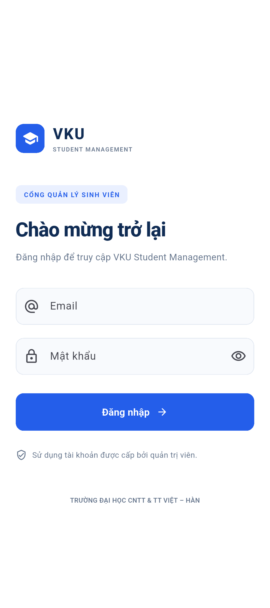
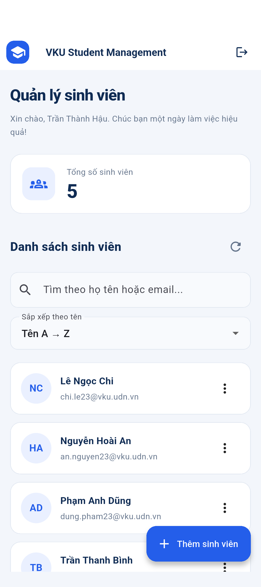
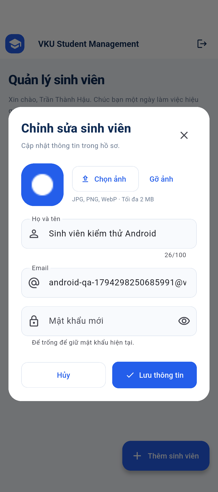
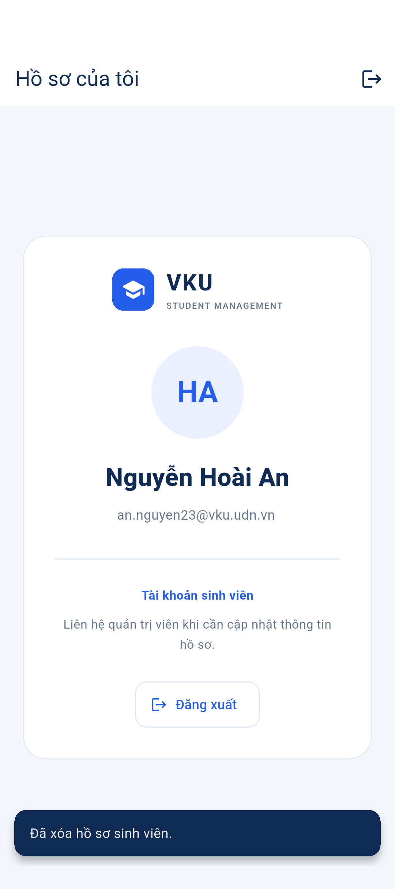

# BÁO CÁO GIỮA KỲ — LẬP TRÌNH ĐA NỀN TẢNG

**Sinh viên thực hiện:** Trần Thành Hậu  
**Đề tài:** Xây dựng ứng dụng Quản lý Sinh viên VKU bằng Flutter và MongoDB  
**Tên tiếng Anh:** VKU Student Management System  
**Mã nguồn:** `vku_student_management`  
**Ngày chuẩn bị tài liệu:** 10/11/2026

Tài liệu này mô tả mã nguồn, cách triển khai và bằng chứng kiểm chứng. Backend đã kết nối Atlas, kiểm tra REST API và chạy kịch bản tích hợp trên Android thật trong máy ảo; ảnh chụp Android nằm ở phần 8. Kiểm tra trực tiếp Chrome, gallery Android, ảnh Compass và video vẫn cần hoàn tất. Source GitHub: [Thanhau1105/mditerm_dnt](https://github.com/Thanhau1105/mditerm_dnt). Kết quả chi tiết nằm trong `VALIDATION.md`.

## 1. Mục tiêu và phạm vi

Ứng dụng cung cấp phân hệ quản trị để nhập, hiển thị, sửa và xóa hồ sơ sinh viên. Một frontend Flutter chạy trên Chrome và Android; backend Node.js xác thực người dùng và lưu dữ liệu vào MongoDB Atlas. MongoDB Compass được dùng quan sát dữ liệu và import/export collection.

Phạm vi dữ liệu theo đề bài chỉ có bốn trường nghiệp vụ: `email`, `matkhau`, `hoten`, `hinhanh`. MongoDB có `_id` hệ thống. Ứng dụng không lưu thêm mã sinh viên, lớp, khoa hoặc vai trò trong document.

| Yêu cầu đề bài | Thành phần đáp ứng |
|---|---|
| Nhập và hiển thị trên Web | Flutter Web, form và danh sách lấy từ API |
| Email, mật khẩu, họ tên, hình ảnh | Schema `backend/models/User.js` |
| Đăng nhập | API `/auth/login`, bcrypt và JWT |
| Sửa, xóa | API `/users/:id`, form sửa và dialog xác nhận |
| Chọn ảnh và hiển thị trên di động | `image_picker`, Base64 và ảnh trong card |
| Cơ sở dữ liệu thật | Mongoose kết nối Atlas theo `.env` |
| Nộp JSON | Bộ mẫu `database/users.json`, script export dữ liệu thực |
| Source, video, báo cáo | Repository Git, kịch bản demo, tài liệu này |

## 2. Công nghệ và kiến trúc

| Lớp | Công nghệ | Trách nhiệm |
|---|---|---|
| Giao diện | Flutter, Dart, Material 3 | Login, dashboard, form, danh sách responsive |
| HTTP client | Package `http` | Gửi JSON và Bearer token tới API |
| Hình ảnh | Package `image_picker` | Chọn ảnh Web/Android, đọc byte và xem trước |
| API | Node.js, Express | Routing, validation, response và lỗi |
| Truy cập dữ liệu | Mongoose | Schema, unique index, truy vấn và lưu MongoDB |
| Xác thực | bcryptjs, jsonwebtoken | Hash mật khẩu, phát và kiểm tra JWT |
| Cấu hình | dotenv, cors | Biến môi trường và cho phép origin Web |
| Kiểm thử API | Node test runner, Supertest, mongodb-memory-server | Gọi HTTP thật vào app với MongoDB tạm độc lập |
| Quản lý database | MongoDB Atlas, Compass | Lưu trữ cloud và kiểm tra trực quan |

Luồng xử lý chính:

```text
Flutter Web / Android
        │ HTTP JSON + Bearer token
        ▼
Express routes → middleware xác thực/quyền → controller/validation
        │
        ▼
Mongoose User model → MongoDB Atlas / vku_student_management.users
                                       ▲
                                       │ kết nối quản lý riêng
                                 MongoDB Compass
```

Flutter chỉ biết địa chỉ REST API. URI database và JWT secret ở backend; không đặt chúng trong Dart hoặc `--dart-define`.

## 3. Thiết kế dữ liệu

Database: `vku_student_management`. Collection: `users`.

| Trường | Kiểu | Quy tắc |
|---|---|---|
| `_id` | ObjectId | MongoDB tự tạo; dùng định danh CRUD |
| `email` | String | Bắt buộc, trim, lowercase, định dạng email, duy nhất |
| `matkhau` | String | Lưu bcrypt hash; không xuất qua API hồ sơ |
| `hoten` | String | Bắt buộc, trim, từ 2 đến 100 ký tự |
| `hinhanh` | String | Base64 ảnh hoặc chuỗi rỗng |

Schema có `timestamps: false`, `versionKey: false`, `strict: 'throw'`. Do đó không sinh `createdAt`, `updatedAt`, `__v`, và không chấp nhận thêm trường nghiệp vụ qua model. Validation đầu vào còn kiểm tra whitelist ở API.

Email có unique index tại database. Kiểm tra frontend giúp báo lỗi sớm; unique index mới bảo vệ được tình huống hai yêu cầu gửi cùng email gần như đồng thời. Backend chuyển lỗi trùng thành HTTP `409`.

Mật khẩu người dùng nhập cần ít nhất 6 ký tự và tối đa 72 byte UTF-8. Giới hạn byte phù hợp giới hạn đầu vào bcrypt và khác với số ký tự khi dùng tiếng Việt. Trước khi lưu mật khẩu thay đổi, model hash bằng bcrypt với cost 12. Khi sửa, ô mật khẩu mới để trống giữ hash cũ.

Ảnh chấp nhận JPEG, PNG hoặc WebP, tối đa 2 MiB dữ liệu byte. Backend kiểm tra Base64, kích thước giải mã và dấu hiệu định dạng; chuỗi rỗng đại diện chưa có ảnh. Dữ liệu ảnh nằm ngay trong `hinhanh`, không tạo collection ảnh. Base64 làm dữ liệu lớn hơn byte ảnh nên giới hạn request JSON phải lớn hơn giới hạn ảnh nhị phân.

Bộ mẫu gồm 5 hồ sơ. Tài khoản quản trị mẫu cũng nằm trong `users`; tổng số hiển thị đếm tất cả document, bao gồm hồ sơ này. Không thêm `role`: backend so sánh email với `ADMIN_EMAIL` của môi trường.

## 4. Phân chia mã nguồn

| File/thư mục | Chức năng |
|---|---|
| `backend/config/env.js` | Đọc, kiểm tra cấu hình môi trường |
| `backend/config/db.js` | Kết nối MongoDB, cố định tên database |
| `backend/models/User.js` | Schema bốn trường, hash và public projection |
| `backend/controllers/authController.js` | Đăng nhập, trả thông tin phiên |
| `backend/controllers/userController.js` | CRUD, tìm kiếm, sắp xếp và đếm hồ sơ |
| `backend/middleware/authMiddleware.js` | Kiểm tra JWT và quyền quản trị tại server |
| `backend/routes/` | Khai báo endpoint xác thực và người dùng |
| `backend/utils/validation.js` | Email, mật khẩu, ảnh, body whitelist và ObjectId |
| `backend/app.js` | Express app, CORS, JSON limit, routing, lỗi |
| `backend/server.js` | Kết nối MongoDB và mở cổng HTTP |
| `backend/scripts/seed.js` | Nạp hồ sơ mẫu còn thiếu |
| `backend/scripts/create-fixture.js` | Sinh JSON mẫu với bcrypt hash |
| `backend/scripts/export.js` | Xuất dữ liệu thực dạng Extended JSON |
| `frontend/lib/main.dart` | Khởi tạo ứng dụng và chuyển Login/Dashboard theo phiên |
| `frontend/lib/models/user_model.dart` | Chuyển JSON thành đối tượng Dart, xử lý ảnh/initials |
| `frontend/lib/services/api_service.dart` | API URL theo nền tảng, HTTP, JSON và lỗi |
| `frontend/lib/services/auth_service.dart` | Trạng thái đăng nhập, token và đăng xuất |
| `frontend/lib/screens/login_screen.dart` | Form đăng nhập và thông báo lỗi |
| `frontend/lib/screens/dashboard_screen.dart` | Khung quản trị responsive |
| `frontend/lib/screens/user_list_screen.dart` | Danh sách, tìm kiếm, sắp xếp và thao tác CRUD |
| `frontend/lib/screens/user_form_screen.dart` | Form thêm/sửa, chọn và xem trước ảnh |
| `frontend/lib/widgets/user_card.dart` | Thẻ sinh viên trên màn hình nhỏ |
| `frontend/lib/widgets/app_theme.dart` | Theme và các thành phần giao diện dùng chung |

Font Roboto được đóng gói cục bộ để dùng tiếng Việt mà không tải font mỗi lần mở app. Nguồn và giấy phép: [Google Fonts — Roboto](https://github.com/google/fonts/tree/main/ofl/roboto); xem file OFL trong `frontend/assets/fonts/`.

## 5. Các bước triển khai

### Bước 1 — Môi trường

Kết quả đầu vào sinh viên đã cung cấp: Flutter `3.47.2`, Dart `3.13.2`, Node.js `24.19.0`, npm `12.0.2`; Chrome được Flutter nhận diện; có máy ảo `Pixel_9_API_36`. Android toolchain lúc kiểm tra ban đầu thiếu `cmdline-tools`. Các lệnh local chưa phát hiện MongoDB Server ở cấu hình mặc định, nên dự án chuẩn bị kết nối Atlas.

Các công cụ có sẵn được giữ nguyên. Phần Android chỉ cần bổ sung thành phần SDK còn thiếu, chấp nhận giấy phép và xác nhận thiết bị khi chạy trên máy. Không cần C++ toolchain của Windows desktop để nhắm Web/Android.

### Bước 2 — Tạo source và cấu trúc

Tạo `vku_student_management/backend`, `frontend`, `database`, `docs`, `scripts`. Flutter sinh cấu hình Web/Android mặc định; mã giao diện được tách theo model, service, screen và widget. Root `.gitignore` loại `.env`, thư viện cài đặt, build, Android local settings và bản xuất dữ liệu riêng.

Mở trong VS Code:

```powershell
Set-Location -LiteralPath 'D:\HK7\DNT\Midterm\vku_student_management'
code .
```

### Bước 3 — Backend Express

`package.json` định nghĩa `start`, `dev`, `seed`, `fixture`, `export`, `test`. Cài đúng dependency lock:

```powershell
Set-Location -LiteralPath 'D:\HK7\DNT\Midterm\vku_student_management\backend'
npm.cmd ci
```

`app.js` ghép middleware và route; `server.js` chịu trách nhiệm mở kết nối database trước khi listen. Tách hai file giúp test app mà không chạy server production hoặc dùng URI Atlas.

### Bước 4 — Atlas, User model và seed

Thực hiện [ATLAS_COMPASS.md](ATLAS_COMPASS.md), điền URI vào `backend/.env`. Database user kết nối Atlas là tài khoản khác với người đăng nhập Flutter. Cấu hình `ADMIN_EMAIL` trùng email quản trị trong `users`.

```powershell
npm.cmd run seed
```

Seed chỉ thêm email mẫu chưa tồn tại để tránh ghi đè dữ liệu đang dùng. `database/users.json` chứa bcrypt hash của bộ mẫu và có thể import qua Compass. Không nhập lại chuỗi hash vào form mật khẩu Flutter.

### Bước 5 — REST API và kiểm tra

API gồm login, thông tin phiên, danh sách, chi tiết và CRUD. API quản trị đều đi qua `authenticate` và `requireAdmin`. Token không hợp lệ trả `401`; tài khoản hợp lệ nhưng không phải quản trị trả `403`.

```powershell
npm.cmd test
npm.cmd run dev
```

Từ terminal khác:

```powershell
Invoke-RestMethod -Uri 'http://localhost:3000/api/health'
```

Test tự động không chứng minh kết nối Atlas cá nhân đã hoạt động. Sau khi chạy app với URI thật, kiểm tra thêm/thay đổi document trong Compass.

### Bước 6 — Flutter và đăng nhập

```powershell
Set-Location -LiteralPath 'D:\HK7\DNT\Midterm\vku_student_management\frontend'
flutter pub get
```

Login kiểm tra email, yêu cầu mật khẩu, có nút ẩn/hiện và loading khi gọi API. Backend dùng `bcrypt.compare`; kết quả thành công trả token và hồ sơ công khai. `AuthService` thông báo thay đổi trạng thái để chuyển màn hình.

Phiên được giữ trong bộ nhớ. Refresh trang Web yêu cầu đăng nhập lại. Đăng xuất xóa token khỏi client; JWT có thời hạn ở backend. Mỗi request còn kiểm tra tài khoản tồn tại và fingerprint mật khẩu để phát hiện mật khẩu đã đổi.

### Bước 7 — Dashboard và danh sách

Dashboard dành cho quản trị hiển thị lời chào, tổng số document, thanh tìm kiếm, sắp xếp và nút thêm. Trên màn hình rộng dùng sidebar/header và bảng. Màn hình nhỏ dùng AppBar, card và nút thêm thuận tiện thao tác chạm.

Danh sách lấy từ MongoDB thông qua API, không có mảng sinh viên giả thay cho chức năng. Tài khoản thường có thể xem thông tin cá nhân và đăng xuất; backend vẫn chặn API quản trị dù người dùng tự gửi HTTP.

### Bước 8 — Thêm, sửa và xóa

Form thêm yêu cầu email, họ tên và mật khẩu. Form sửa cho phép thay ảnh, tên, email và mật khẩu tùy chọn. Sau lưu thành công, frontend tải lại danh sách và thông báo kết quả. Khi lỗi validation hoặc mất kết nối, giữ form để người dùng sửa/thử lại.

Xóa luôn có dialog xác nhận. Nhấn Hủy không gửi DELETE. Backend bảo vệ việc xóa chính tài khoản quản trị đang dùng hoặc đổi email của tài khoản này để tránh mất quyền được cấu hình qua `.env`.

### Bước 9 — Ảnh Base64

`image_picker` trả `XFile`; frontend gọi `readAsBytes()` để dùng được cả Web và Android, rồi mã hóa Base64. UI xem trước byte ảnh trước khi gửi. Ảnh tải lại từ API được giải mã và hiển thị; hồ sơ chưa có ảnh dùng initials/avatar mặc định.

Luồng kiểm chứng: chọn ảnh → xem trước → lưu → refresh danh sách/trang và đăng nhập lại nếu cần → ảnh vẫn xuất hiện → kiểm tra `hinhanh` trong Compass có giá trị.

### Bước 10 — Tìm kiếm, sắp xếp và trạng thái

Tìm kiếm áp dụng họ tên/email qua tham số `search`. `sort=asc` hoặc `desc` điều khiển chiều sắp xếp tên. Tổng số toàn collection và số dòng khớp bộ lọc có ý nghĩa khác nhau. UI xử lý danh sách rỗng, không có kết quả, loading và lỗi tải dữ liệu.

### Bước 11 — Chạy Web

```powershell
flutter run -d chrome --web-port 5173 --dart-define=API_BASE_URL=http://localhost:3000/api
```

Backend cho phép origin Web port 5173 qua `CORS_ORIGINS`. CORS không thay thế xác thực: API vẫn kiểm tra token và quyền cho mọi request quản trị.

### Bước 12 — Chạy Android

```powershell
flutter emulators --launch Pixel_9_API_36
flutter devices
```

Sau khi máy ảo đã khởi động, thay ID thiết bị theo kết quả thực:

```powershell
flutter run -d emulator-5554 --dart-define=API_BASE_URL=http://10.0.2.2:3000/api
```

Điện thoại thật dùng IPv4 LAN của máy tính thay `10.0.2.2`; cần cùng mạng và backend truy cập được qua firewall. Bản phát triển dùng HTTP; bản công khai cần HTTPS.

### Bước 13 — Xuất JSON và GitHub

```powershell
Set-Location -LiteralPath 'D:\HK7\DNT\Midterm\vku_student_management\backend'
npm.cmd run export
```

File `database/users.export.json` giữ ObjectId bằng Extended JSON và giữ hash. Kiểm tra được import lại trên một database học tập khác trước khi nộp, tránh làm thay đổi collection đang demo.

GitHub: repository [Thanhau1105/mditerm_dnt](https://github.com/Thanhau1105/mditerm_dnt), nhánh `main`. Kiểm tra staging rồi commit/push theo README; không commit `.env` hoặc JSON export riêng.

### Bước 14 — Demo và hoàn thiện báo cáo

Theo [DEMO.md](DEMO.md), quay Web, Compass và Android trong cùng kịch bản để chứng minh dữ liệu bền vững. Chụp bằng chứng đúng lúc thao tác, che thông tin kết nối riêng. Đánh dấu [CHECKLIST_NOP_BAI.md](CHECKLIST_NOP_BAI.md) theo kết quả thật.

## 6. API và xử lý lỗi

| API | Mục đích | Xác thực |
|---|---|---|
| `POST /api/auth/login` | Kiểm tra email/mật khẩu, trả JWT | Công khai, giới hạn tần suất |
| `GET /api/auth/me` | Trả hồ sơ của phiên | Token hợp lệ |
| `GET /api/users` | Danh sách + tổng, tìm và sắp xếp | Quản trị |
| `GET /api/users/:id` | Chi tiết hồ sơ | Quản trị |
| `POST /api/users` | Thêm hồ sơ | Quản trị |
| `PUT /api/users/:id` | Sửa hồ sơ | Quản trị |
| `DELETE /api/users/:id` | Xóa hồ sơ | Quản trị |

Validation chạy lại ở server để bảo vệ API khi không đi qua form Flutter. Body chỉ nhận trường được cho phép; ObjectId sai định dạng bị từ chối; ảnh quá lớn hoặc không đúng Base64 bị từ chối. `matkhau` được loại khỏi dữ liệu trả về bằng whitelist và cấu hình select của model.

Thông báo client hiển thị bằng tiếng Việt. Backend trả `400`, `401`, `403`, `404`, `409`, `429` tương ứng loại lỗi; lỗi nội bộ không gửi stack trace/URI ra response. Frontend chuyển lỗi HTTP hoặc mất kết nối thành thông báo dễ hiểu.

## 7. Ma trận kiểm thử cần ghi nhận

Kết quả phân biệt kiểm thử tự động trên MongoDB tạm, gọi API Atlas thật và chạy ứng dụng trên Pixel 9 / Android 16 API 36. Không suy ra đã thao tác Compass hoặc gallery từ kết quả API.

| Mã | Tình huống | Kết quả mong đợi | Kết quả thực tế |
|---|---|---|---|
| T01 | Đăng nhập quản trị đúng | Vào dashboard, có thao tác quản trị | Đạt trên Android + API Atlas |
| T02 | Sai mật khẩu | Báo lỗi, không vào dashboard | Đạt qua backend/widget tests |
| T03 | Đăng nhập tài khoản thường | Xem hồ sơ, không quản lý danh sách | Đạt trên Android + API Atlas |
| T04 | Gọi GET users không token | HTTP 401 | Đạt trong backend tests với MongoDB tạm |
| T05 | Gọi CRUD bằng token tài khoản thường | HTTP 403 | Đạt qua API Atlas |
| T06 | Thêm hồ sơ có ảnh | Thêm thành công, Compass thấy dữ liệu và hash | Đạt API Atlas và đối chiếu MongoDB; ảnh Compass còn thiếu |
| T07 | Thêm email trùng, khác chữ hoa/thường | HTTP 409, không tăng số hồ sơ | 409 đạt trên Atlas; chuẩn hóa chữ thường có backend tests |
| T08 | Email/tên/mật khẩu không hợp lệ | Form/API báo lỗi rõ ràng | Đạt qua backend/widget tests |
| T09 | Sửa tên, bỏ trống mật khẩu | Tên đổi, mật khẩu cũ vẫn đăng nhập được | Đạt trên Android + API Atlas |
| T10 | Sửa mật khẩu | Mật khẩu mới dùng được, token cũ bị từ chối ở request tiếp | Đạt trong backend tests với MongoDB tạm |
| T11 | Đổi ảnh, tải lại hồ sơ | Ảnh mới vẫn hiển thị | Đạt Android tải/preview ảnh từ Atlas; ảnh được nạp qua API |
| T12 | Hủy dialog xóa | Hồ sơ còn nguyên | Đạt trên Android + Atlas |
| T13 | Xác nhận xóa | Hồ sơ mất ở UI và Compass | Đạt Android + API Atlas; chưa chụp Compass |
| T14 | Xóa/đổi email quản trị hiện tại | Backend từ chối thao tác bảo vệ | Đạt trong backend tests với MongoDB tạm |
| T15 | Tìm tên/email, đổi chiều sắp xếp | Kết quả và thứ tự tương ứng | Tìm kiếm đạt Android/Atlas; sắp xếp có backend tests |
| T16 | Bộ lọc không có kết quả | Thông báo phù hợp, có cách xóa bộ lọc | Đạt trên Android sau khi xóa hồ sơ thử |
| T17 | Dừng backend rồi thao tác | Báo mất kết nối, có thể thử lại | Widget test 503/retry đạt; chưa ngắt backend thật |
| T18 | Ảnh sai định dạng/quá 2 MiB | Bị từ chối, dữ liệu cũ không mất | Đạt trong backend tests |
| T19 | Body chứa trường `role` hoặc toán tử truy vấn | API từ chối trường lạ | Đạt trong backend tests |
| T20 | Web rộng/hẹp và Android | Bố cục dùng được, không overflow | Widget tests 320/390/960/1440 px và Android thật đạt |
| T21 | Chọn ảnh trên Android | Có preview, lưu và hiển thị lại | Preview/lưu/hiển thị đạt; gallery gốc chưa kiểm tra |
| T22 | Xuất/import JSON | Đúng trường, hash và ObjectId, đăng nhập sau import | Đã xuất 5 hồ sơ Atlas; import Compass còn cần kiểm tra |
| T23 | Đăng xuất | Quay về Login, dữ liệu phiên client bị xóa | Đạt trên Android |

Lệnh kiểm thử nguồn:

```powershell
# Trong backend
npm.cmd test

# Trong frontend
flutter analyze
flutter test
flutter build web --dart-define=API_BASE_URL=http://localhost:3000/api
```

Ghi số lượng test và kết quả đúng với log của lần chạy cuối, không suy ra từ số dòng trong bảng này. Backend integration tests dùng MongoDB tạm thật; widget/service tests của Flutter không thay thế chạy camera/gallery, Chrome và Atlas thực.

## 8. Danh sách ảnh minh họa

| Ảnh | Nội dung cần chụp | Gợi ý tên file |
|---|---|---|
| 01 | Cấu trúc thư mục trong VS Code | `01-source.png` |
| 02 | Backend kết nối database và listen, không có URI | `02-backend.png` |
| 03 | Login Web | `03-login-web.png` |
| 04 | Dashboard có danh sách MongoDB | `04-dashboard-web.png` |
| 05 | Thêm sinh viên và preview ảnh | `05-add-preview.png` |
| 06 | Kết quả lưu và document tương ứng trong Compass | `06-compass-document.png` |
| 07 | Sửa và thông báo thành công | `07-edit.png` |
| 08 | Dialog xác nhận xóa | `08-delete-confirm.png` |
| 09 | Tìm kiếm/sắp xếp | `09-search-sort.png` |
| 10 | Danh sách Android và ảnh vừa chọn | `10-android.png` |
| 11 | Kết quả tests/analyze/build thực | `11-validation.png` |
| 12 | File JSON xuất và repo GitHub | `12-submission.png` |

Chèn ảnh chụp thực vào bản báo cáo nộp cuối. Không dùng ảnh minh họa được dựng để thay bằng chứng chức năng. Khi chụp Compass, thu gọn Base64 và che thông tin kết nối; tránh ghi mật khẩu Atlas hoặc `.env` trong video.

### Ảnh Android đã ghi nhận

Các ảnh dưới đây được chụp từ ứng dụng Flutter chạy trên Pixel 9 Emulator, Android 16 API 36, kết nối backend thật và Atlas. Hồ sơ kiểm thử riêng trong ảnh sửa đã được xóa sau khi kiểm tra.

**Màn hình đăng nhập:**



**Dashboard đọc 5 hồ sơ từ Atlas:**



**Form sửa hiển thị ảnh đọc lại từ Atlas:** Ảnh thử được nạp bằng API để kiểm tra đọc/preview, không dùng ảnh này để khẳng định đã thao tác gallery gốc.



**Tài khoản sinh viên chỉ xem hồ sơ cá nhân:**



## 9. Giới hạn và hướng phát triển

- Đề bài giới hạn bốn trường, nên cấu hình một email quản trị nằm ngoài document và chưa có quản trị nhiều vai trò trong database.
- Base64 phù hợp ảnh nhỏ của bài thực hành, nhưng làm tăng kích thước database/response. Hệ thống lớn nên cân nhắc object storage và lưu URL khi được phép đổi schema.
- Danh sách hiện dành cho quy mô bài học. Khối lượng lớn cần phân trang, giảm ảnh ở API danh sách và tối ưu tìm kiếm.
- Phiên ở bộ nhớ nên refresh Web cần đăng nhập lại. Không có chức năng quên mật khẩu/gửi email hoặc thu hồi phiên riêng biệt trong database.
- Chỉ kiểm tra dữ liệu ảnh cơ bản ở backend; hệ thống công khai cần pipeline giải mã/giới hạn kích thước pixel và xử lý lại ảnh.
- HTTP được dùng trong phát triển local. Deploy thật cần HTTPS, secret riêng và cấu hình origin/mạng phù hợp.

## 10. Thông tin nộp cuối

| Mục | Giá trị sinh viên điền sau khi hoàn tất |
|---|---|
| Link GitHub | https://github.com/Thanhau1105/mditerm_dnt |
| Link video demo | Chưa điền — quay và tải video thật |
| Thiết bị Android/phiên bản | Pixel 9 Emulator, Android 16 API 36, emulator-5554 |
| Phiên bản Chrome lúc demo | Chưa ghi nhận |
| Kết quả kết nối Atlas | Thành công; 5 tài khoản mẫu, CRUD/ảnh đã kiểm tra qua API và Android |
| File database nộp | `database/users.export.json` xuất từ Atlas; `database/users.json` là bộ mẫu |
| Báo cáo kèm ảnh | Đã có 4 ảnh Android thật; còn ảnh Web/Compass và video |
